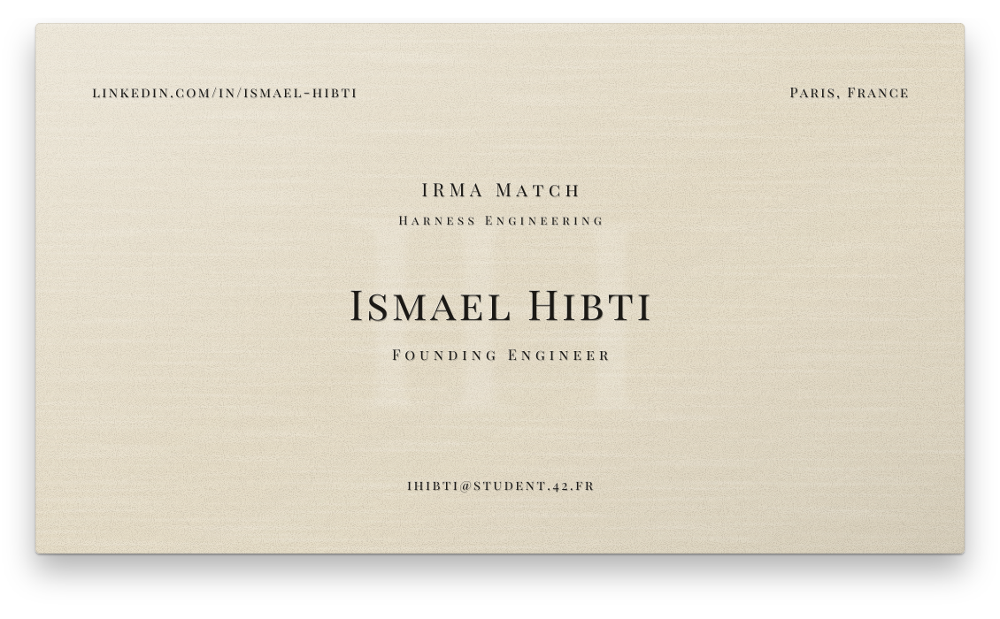

  

I'm Ismael, founding engineer at [IRMA Match](https://irmamatch.com), in Paris.

I build harnesses for agents that read public tenders, extract and normalize what matters, and crawl the web for the architecture and engineering firms that bid on them, so people spend their intelligence on the decision instead of the search. The agents run on Mistral models.

In November 2026, my team finished 5th out of 80 at the [European AI Championship](https://github.com/ihibti/euro-ai-championship-2026). Most of the work ran overnight, done by coding agents inside a harness I built that capped what they could spend and submit.

I contribute to open source: a merged fix in [xberg](https://github.com/xberg-io/xberg/pull/1969), and a crash fix in review at [TimescaleDB](https://github.com/timescale/timescaledb/pull/10728).

I studied math at UQAM and computer science at 42, and I still think fundamentals compound. I've written [linear algebra from scratch in Rust](https://github.com/ihibti/matrix-rs), a [Unix shell](https://github.com/ihibti/minishell), an [IRC server](https://github.com/ihibti/ft_irc), a [real-time Pong](https://github.com/42-Cursus-Ft-transcendence/Ft_transcendence), and a [raycasting engine](https://github.com/ihibti/cub3d), still my favourite:

https://github.com/user-attachments/assets/7c3de487-aca8-4667-bbb7-c9f742d86ae1

Off the keyboard, I train jiu-jitsu. On it, I reach for Rust whenever I can.

**[Write to me ›](mailto:ihibti@student.42.fr)** &nbsp;·&nbsp; [LinkedIn](https://www.linkedin.com/in/ismael-hibti/)

 

<picture>
  <source media="(prefers-color-scheme: dark)" srcset="assets/signature-dark.svg">
  
</picture>
